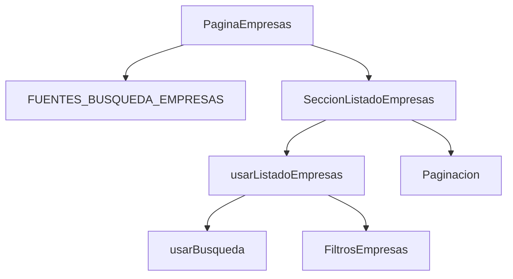
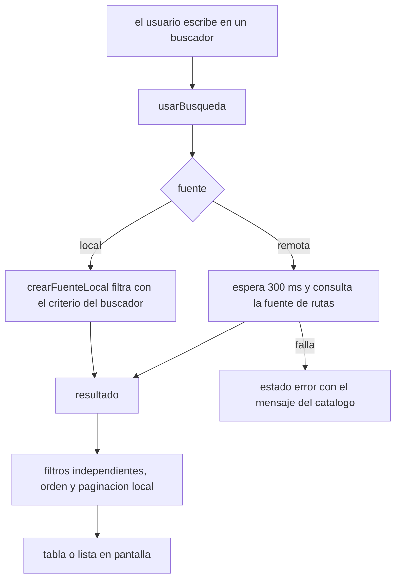

# Documentación técnica: Red Social

Capacidad: redsocial
Responsable: equipo_redsocial
Fecha: 2026-11-10
Versión: 1.0.0

## 1. Qué hace y hasta dónde llega

Es el módulo de red social de CodePlex. Reúne 18 subcapacidades de pantalla y 49 páginas.

- Subcapacidades: acceso, actividad, amigos, avisos, colaboradores, dashboard, empresas, estadísticas, eventos, grupos, guardados, indicadores, inicio, marketplace, mensajería, perfil, reportes y lo compartido.
- Recibe: las acciones del usuario en pantalla, como buscar, filtrar, paginar, crear, editar, enviar mensajes o contratar un plan.
- Devuelve: el resultado visual de cada acción.
- Aplica: textos en catálogos, búsquedas con criterio definido, paginación local y flujos de pago demostrativos.
- Pendiente: no existe backend ni base de datos. El manifiesto declara `usa_backend` y `usa_base_datos` en `false`.
- Pendiente: los datos son de demostración, viven en memoria y se pierden al recargar.
- Pendiente: no existen búsquedas remotas ni paginación remota.

## 2. Dónde empieza y cómo se organiza

La aplicación de montaje local, que está fuera de esta capacidad, carga `frontend/rutas/compartido/rutas.tsx`. Ese archivo importa las páginas y elige una según la ruta.

Capas del frontend, de afuera hacia adentro:

- `frontend/paginas` compone cada pantalla.
- `frontend/componentes` presenta, en la carpeta `bloques` de cada módulo.
- `frontend/rutas` entrega a las páginas los datos y las fuentes de búsqueda.
- `frontend/servicios` guarda los datos de demostración.
- `frontend/tipos` declara contratos y modelos.
- `frontend/catalogos/capacidades/redsocial` guarda textos, clases y configuración de cada módulo.

Reglas de organización:

- Un componente no importa servicios ni rutas. Lo comprueba `frontend/pruebas/compartido/prevencion_arquitectura.test.tsx`.
- Los controles comunes están en `frontend/componentes/compartido`. Envuelven los componentes de las librerías oficiales de CodePlex sin modificarlas.
- No comparte archivos con otras capacidades.
- Mientras no haya backend, no necesita el contexto activo de la plataforma.

## 3. Cómo recorre el sistema una operación

Ejemplo: el usuario escribe en «Buscar empresa por nombre o RUC». `FiltrosEmpresas` entrega el texto a `usarListadoEmpresas`. Este hook consulta una fuente con `usarBusqueda`, aplica los filtros independientes, ordena y pagina.

| Operación | Frontend | Backend | Base de datos |
|---|---|---|---|
| Buscar y paginar empresas | `PaginaEmpresas` llama a `SeccionListadoEmpresas` y a `usarListadoEmpresas` | No aplica: no hay backend | No aplica: los datos están en `frontend/servicios/empresas` |
| Historial y usuarios de una empresa | Las pestañas del detalle usan `usarHistorialEmpresa` y `usarUsuariosEmpresa` | No aplica: no hay backend | No aplica: los datos están en `frontend/servicios/empresas` |
| Buscar en Marketplace | `PaginaMarketplace` usa `BUSQUEDA_DESTACADOS_MARKETPLACE` | No aplica: no hay backend | No aplica: los datos están en `frontend/servicios/marketplace` |
| Buscar en Guardados | `PaginaGuardados` usa `BUSQUEDA_GRUPOS_GUARDADOS` | No aplica: no hay backend | No aplica: los datos están en `frontend/servicios/guardados` |
| Mensajería | `PaginaMensajesTodos` y los bloques de `frontend/componentes/mensajeria` | No aplica: no hay backend | No aplica: el almacén está en memoria en `frontend/servicios/mensajeria` |

## 4. Funciones importantes y puntos de mantenimiento

- Búsqueda: `usarBusqueda`, `crearFuenteLocal` y `contieneTexto` están en `frontend/componentes/compartido/interfaz`. Un cambio ahí afecta a los 20 buscadores.
- Normalización de texto: `normalizarTexto`, en `frontend/componentes/compartido/interfaz/buscar_opciones_locales.ts`.
- Criterio de cada buscador: funciones como `coincideEmpresa`, `coincideUsuario`, `coincideRegistro`, `coincideColaborador` y `coincideDestacado`, en los archivos `logica_*.ts` de cada módulo.
- Tablas: `CLASES_TABLA` y los hooks `usarListadoEmpresas`, `usarUsuariosEmpresa` y `usarHistorialEmpresa`.
- Paginación: `Paginacion` envuelve el paginador oficial. Los tamaños de página están en los catálogos.
- Textos: cualquier cambio visible se hace en el catálogo del módulo.
- Estado de pantallas grandes: los hooks `usarModalRol`, `usarModalCrearGrupo`, `usarListaConversaciones`, `usarFiltroUbicacion` y `usarEventosParaTi` concentran el estado. Los componentes solo dibujan.
- Mapas: `usarIconoMarcadorMapa` pide Leaflet con `import()` al crear el marcador. La librería oficial de mapas también lo importa, así que Vite no lo separa del paquete principal.
- Pago: `ContenidoFlujoPago` compone las secciones. `VentanasFlujoPago` agrupa el aviso y los dos modales.
- Entradas con varios datos: las funciones que reciben más de cuatro valores usan un objeto de contrato, por ejemplo `enviarMensajePropio(estado, solicitud, contexto)`.

## 5. Dependencias e impacto de los cambios

Depende de React 19, TypeScript 6, Vite 8, Tailwind 4, MUI 7, TanStack Table 9 y las librerías oficiales de CodePlex. Se declaran en el archivo de dependencias de la raíz del repositorio.

No usa servicios externos en ejecución. La única excepción es la carga de fuentes de iconos desde Google Fonts.

Impacto de los cambios:

- Cambiar `frontend/catalogos/capacidades/redsocial/compartido.json` cambia clases y textos de todos los módulos.
- Cambiar un contrato de `frontend/tipos/compartido` obliga a revisar a sus consumidores y sus pruebas.
- Cambiar un catálogo obliga a revisar las pruebas que leen sus claves.

## 6. Errores posibles y cómo investigarlos

- Una fuente de búsqueda falla: el hook expone el estado `error` y la pantalla muestra «No pudimos completar la búsqueda. Inténtalo de nuevo.».
- Llega tarde una respuesta vieja: se descarta. Si aparece un resultado antiguo, revisar `frontend/pruebas/compartido/usar_busqueda.test.tsx`.
- Los datos de demostración desaparecen: es lo esperado, porque viven en memoria.
- Un texto o una clave de catálogo no existe: `npx tsc -b` lo indica en el archivo afectado.
- No hay registros de servidor, porque no hay backend. Los fallos se investigan con las pruebas y con el navegador.

## 7. Riesgos y limitaciones

- Sin persistencia. Consecuencia: todo se pierde al recargar. Estado: confirmado. Acción: integrar con Backend.
- La sesión es de demostración: `frontend/componentes/compartido/sesion/usar_sesion_demostracion.ts`. Consecuencia: no hay autenticación ni permisos reales. Estado: confirmado. Acción: usar la sesión de la plataforma.
- Los chips de categorías de Guardados no filtran. El botón «Buscar» de Eventos no tiene función. Estado: confirmado.
- Los flujos de pago son demostrativos. Consecuencia: no hay cobro, prorrateo ni impuestos reales. Estado: confirmado.
- El paquete principal pesa unos 3,4 MB (943 kB comprimido). Estado: medido el 2026-11-10 con `npm run build`. Acción: cargar bajo demanda la exportación y los mapas.

## 8. Pruebas realizadas

Suite completa de Vitest el 2026-11-10, con `npx vitest run`:

- 186 archivos y 1587 pruebas.
- 1586 pasaron.
- 1 falla, preexistente y ajena a los buscadores: `frontend/pruebas/empresas/mejora_plan_cancelacion.test.tsx`.

Pruebas por área:

- Búsquedas: un archivo `busqueda_fuentes_*.test.tsx` en la carpeta de pruebas de cada módulo, más las de infraestructura en `frontend/pruebas/compartido`. Resultado esperado: criterio correcto, filtros independientes, carga, vacío, error y descarte de respuestas obsoletas.
- Enlaces externos: `frontend/pruebas/compartido/enlaces_externos_seguros.test.tsx`.
- Tipos: `npx tsc -b`. Compilación: `npm run build`.

Sin probar: integración real con servidor, rendimiento con miles de registros y lector de pantalla en todas las pantallas.

## 9. Diagramas Mermaid





## 10. Decisiones técnicas y su motivo

- Las páginas se importan de forma estática. Con carga perezosa, el cambio de ruta desmonta la estructura y muestra una pantalla en blanco. El detalle está en `frontend/guia/decisiones_arquitectura_spa.md`.
- Los textos y las clases viven en catálogos JSON. Así cambiarlos no exige tocar componentes.
- Las búsquedas separan el texto de los filtros independientes. Los filtros viajan como un parámetro aparte, para que una fuente remota los reciba sin mezclar criterios.
- Se envuelven los componentes de las librerías oficiales en lugar de modificarlos. Así se conserva el diseño propio.
- Límite: una fuente remota exige un contrato de servidor que hoy no existe.
- Cada componente exportado vive en su propio archivo. Los componentes pequeños y dependientes se separan solo cuando aportan una responsabilidad propia.
- Las pertenencias dentro de recorridos usan `Set` o `Map`. Las listas pequeñas de casillas se indexan una vez antes de dibujar.

## 11. Contratos de entrada y salida

Toda búsqueda cumple `FuenteBusqueda`. Recibe la consulta, un límite opcional y los filtros. Devuelve `ResultadoBusquedaLista` o su promesa.

```json
{ "consulta": "norte", "filtros": { "estado": "Activa" } }
```

```json
{ "elementos": [ { "nombre": "Constructora del Norte SAC" } ], "total": 1 }
```

Un error de la fuente es `{ "codigo": "no_disponible" }`. Los otros códigos son `consulta_invalida` y `sin_permiso`.

Si cambia un campo, cambian también `frontend/tipos/compartido/contrato_busqueda.ts` y los hooks que lo usan.

## 12. Seguridad y aislamiento entre empresas

- No hay backend. La plataforma resolverá la sesión, los permisos y el aislamiento por empresa cuando exista la integración. Hoy los datos son de demostración y no hay datos de otras empresas que proteger.
- Los enlaces que abren una pestaña nueva declaran `rel="noopener noreferrer"`. Una prueba lo comprueba en todos los archivos TSX.
- Los textos del usuario se muestran como texto de React, no como HTML.
- No se usa el almacenamiento local del navegador, así que no se guardan datos sensibles allí.

## 13. Integridad de datos y operaciones simultáneas

No aplica: no hay persistencia ni acceso simultáneo. Los datos viven en memoria dentro de cada pestaña del navegador.

Las operaciones de demostración, como guardar una tarjeta o un perfil de facturación, se aplican completas o no se aplican. Un indicador de operación en curso evita ejecutarlas dos veces a la vez.

## 14. Rendimiento y límites comprobados

Comprobado el 2026-11-10 con `npm run build`:

- El paquete principal pesa 3,41 MB (943 kB comprimido).
- Las listas y tablas paginan en el cliente, con tamaños de 5, 6 y 10 filas.

Sospechado, no medido: el filtrado local de listas con miles de filas. La exportación a Excel y PDF se carga bajo demanda. Leaflet sigue en el paquete principal por la librería de mapas.

Pendiente: medir con volúmenes reales cuando exista la fuente remota.

## 15. Instalación, despliegue y migraciones

Migraciones: no aplica, porque no hay base de datos.

- Instalación: `npm install` en la raíz del repositorio.
- Desarrollo: `npm run dev`.
- Compilación: `npm run build`.
- Despliegue: `npm run desplegar`, que compila y sube el resultado.

Para volver atrás se publica la compilación anterior. No hay datos que revertir.

## 16. Monitoreo y recuperación ante fallos

No hay monitoreo de servidor, porque no existe backend. Los fallos de pantalla se siguen con las pruebas (`npx vitest run`) y con el navegador.

La validación arquitectónica se ejecuta con el script de la carpeta de herramientas de validación del repositorio. Sus resultados quedan en la carpeta de resultados de validación.

Ante un fallo se recarga la página. No queda nada a medias, porque nada se persiste.
